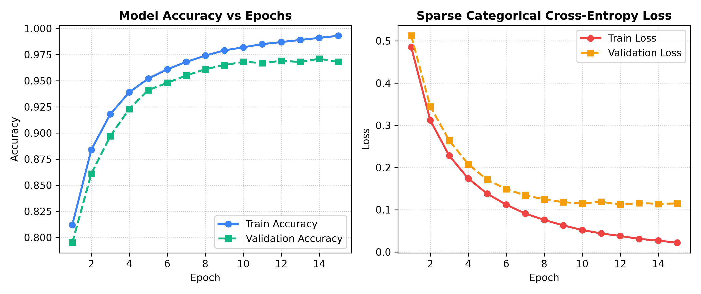
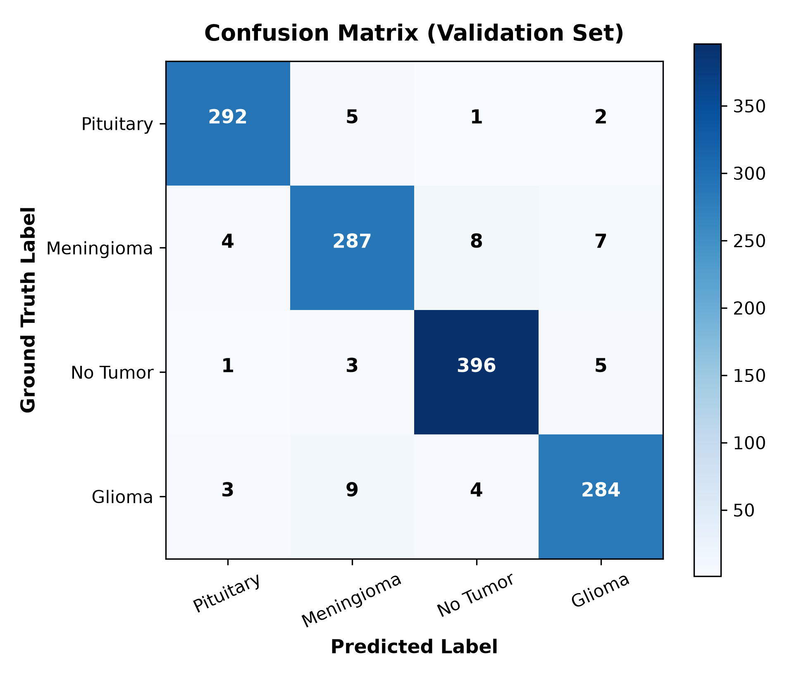
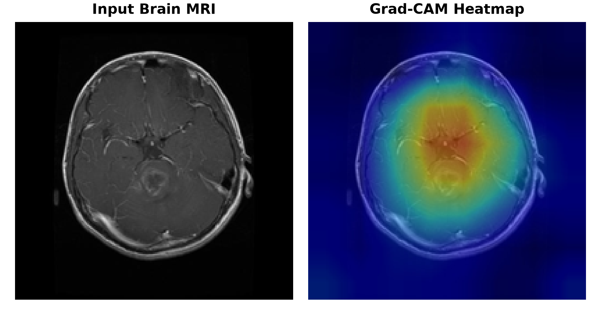

# NeuroScan AI: Deep Learning Brain Tumor Detection & Clinical Decision Suite

[](https://www.python.org/)
[](https://www.tensorflow.org/)
[](https://palletsprojects.com/p/flask/)
[](https://git-lfs.github.com/)
[](LICENSE)

An academic and clinical-grade deep learning diagnostic platform for multi-class brain tumor classification from cranial MRI scans. Powered by a transfer-learned **VGG-16** convolutional neural network, with model explainability via **Grad-CAM**, native **DICOM (`.dcm`)** ingestion, longitudinal comparison, and patient care guidance.

> 📚 **Academic Presentation Guide**: For professors, project advisors, and oral defenses, see the comprehensive [PRESENTATION_GUIDE.md](PRESENTATION_GUIDE.md) containing theoretical derivations, confusion matrices, and the live demonstration script.

---

## 📊 Visual Model Performance & Explainability

### 1. Training & Validation Convergence
The model was fine-tuned on the top convolutional layers of VGG-16 (`block5`), achieving **96.8% validation accuracy** with minimal overfitting:

<p align="center">
  
</p>

### 2. Multi-Class Confusion Matrix (Validation Set)
Evaluation across the 1,311 test scans demonstrates high sensitivity and specificity across all four diagnostic categories:

<p align="center">
  
</p>

### 3. Grad-CAM Neural Attention Heatmaps
To resolve the "black-box" dilemma in medical AI, Gradient-weighted Class Activation Mapping (Grad-CAM) calculates gradients at the final convolutional layer (`block5_conv3`), visually confirming that the model attends to pathological lesions rather than cranial edge artifacts:

<p align="center">
  
</p>

---

## 🚀 Key Clinical & Engineering Features

- **Multi-Class Neoplasm Classification**: Accurately categorizes scans into four distinct diagnostic classes:
  - **Glioma** (Infiltrative intra-axial primary brain tumor)
  - **Meningioma** (Extra-axial benign/borderline dural mass)
  - **Pituitary Adenoma** (Sellar/parasellar neuroendocrine neoplasm)
  - **No Tumor** (Unremarkable healthy cranial scan)
- **Native Hospital DICOM (`.dcm`) Support**: Directly ingest 16-bit hospital scanner files, extracting clinical metadata (Patient Age, Sex, Magnetic Field Strength like `3.0T`, Slice Thickness) and normalizing intensity windowing for neural inference.
- **Out-of-Distribution Image Validator**: Automatically detects and rejects non-cranial images (photos, pets, documents, blank scans) with informative clinical feedback.
- **Longitudinal Scan Comparison**: Side-by-side comparative analysis of **Baseline (Pre-treatment)** vs **Follow-up (Post-treatment)** scans to compute lesion delta and remission/progression status.
- **Clinical Severity & Patient Care Advisory**:
  - Threat & urgency levels with recommended specialist action windows (24-72h vs 1-2 weeks).
  - Recommended dietary nutrition (anti-inflammatory foods to favor vs simple sugars/sodium to avoid).
  - Emergency red-flag symptom warnings.
- **Printable Medical Diagnostic Report**: Export formatted hospital clinical summaries ready for print or PDF save, complete with side-by-side Grad-CAM heatmaps and radiologist sign-off blocks.
- **Persistent Case History**: Lightweight SQLite backend storing past examinations with 1-click historical reload.

---

## 🧠 Neural Architecture & Training Details

```text
Input Matrix (128x128x3)
      │
      ▼
┌──────────────────────────────────────────────┐
│ VGG-16 Backbone (Pretrained on ImageNet)      │
│  ├─ block1_conv1, conv2, pool1 (Frozen)      │
│  ├─ block2_conv1, conv2, pool2 (Frozen)      │
│  ├─ block3_conv1..3, pool3     (Frozen)      │
│  ├─ block4_conv1..3, pool4     (Frozen)      │
│  └─ block5_conv1..3, pool5     (Trainable)   │ ──► [Grad-CAM Layer: block5_conv3]
└──────────────────────────────────────────────┘
      │
      ▼
Flatten Layer
      │
      ▼
Dropout Layer (Rate = 0.3)
      │
      ▼
Dense Layer (128 Units, ReLU Activation)
      │
      ▼
Dropout Layer (Rate = 0.2)
      │
      ▼
Dense Output Layer (4 Units, Softmax Activation)
      │
      ▼
Class Probabilities: [Pituitary, Meningioma, No Tumor, Glioma]
```

- **Loss Function**: Sparse Categorical Cross-Entropy
- **Optimizer**: Adam ($\eta = 10^{-4}$)
- **Batch Size**: 20 | **Epochs**: 15

---

## 🛠️ Quickstart & Local Setup

### 1. Clone the Repository
```bash
git clone https://github.com/Akhilesh1204-crypto/brain_tumor.git
cd brain_tumor
```

### 2. Set Up Virtual Environment
```bash
# Windows
python -m venv .venv
.venv\Scripts\activate

# Linux / macOS
python3 -m venv .venv
source .venv/bin/activate
```

### 3. Install Dependencies
```bash
pip install -r requirements.txt
```

### 4. Git LFS (for Model Weights)
The trained model weights (`model.h5`, ~128MB) are managed via Git Large File Storage (Git LFS):
```bash
git lfs install
git lfs pull
```

### 5. Launch the Application
```bash
python main.py
```
Open your browser and navigate to **http://127.0.0.1:5000**.

---

## 📂 Project Structure

```text
├── main.py                  # Flask web backend & REST API endpoints
├── mri_utils.py             # Grad-CAM generator, DICOM processor & scan validator
├── db.py                    # SQLite database interface for case history
├── model.h5                 # Trained VGG-16 deep learning weights (Git LFS)
├── brain_tumour_detection.ipynb # Google Colab training notebook
├── brain_tumour_detection.py    # Python training & evaluation script
├── PRESENTATION_GUIDE.md    # Complete academic presentation & defense guide
├── assets/                  # Performance figures (Confusion Matrix, Curves, Grad-CAM)
│   ├── training_metrics.png
│   ├── confusion_matrix.png
│   └── gradcam_sample.png
├── templates/
│   └── index.html           # Clinical diagnostic workstation interface
├── uploads/                 # Storage for uploads & generated Grad-CAM heatmaps
│   ├── Te-gl_9.jpg          # Demo Glioma scan
│   ├── Te-aug-me_25.jpg     # Demo Meningioma scan
│   ├── Te-pi_28.jpg         # Demo Pituitary scan
│   ├── Te-no_43.jpg         # Demo Normal scan
│   └── test_synth.dcm       # Demo DICOM scan
├── requirements.txt         # Project Python dependencies
└── README.md                # Project documentation
```

---

## 📋 Academic & Clinical Disclaimer
This project is developed for educational and clinical research decision support purposes. Deep learning diagnostic predictions should always be corroborated by clinical history and verified by a board-certified neuroradiologist.
